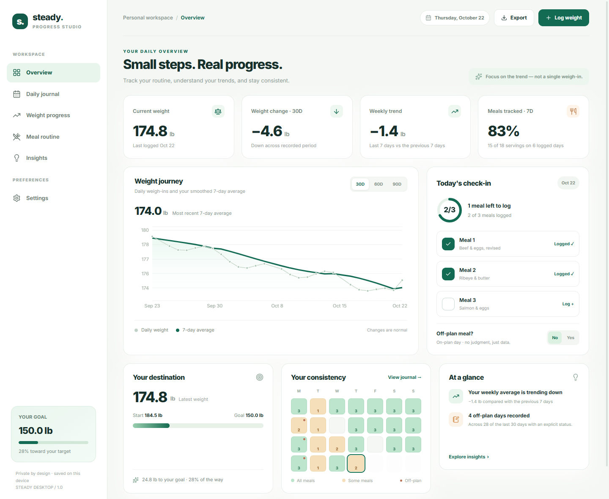
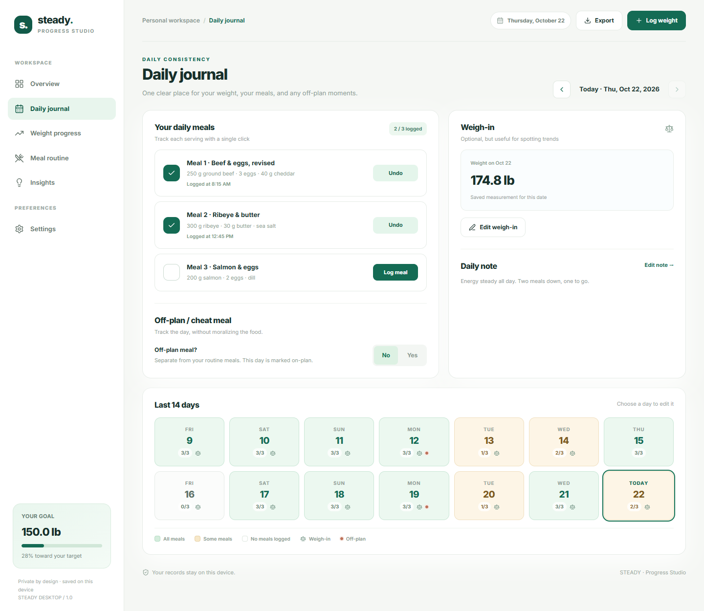
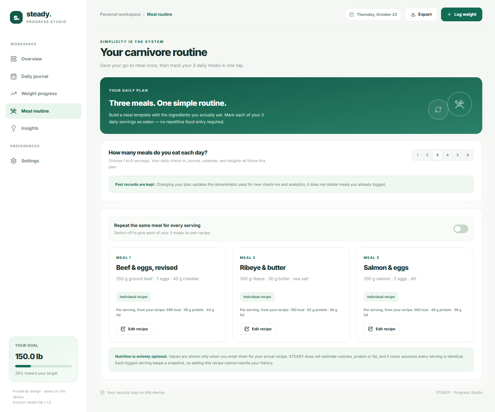
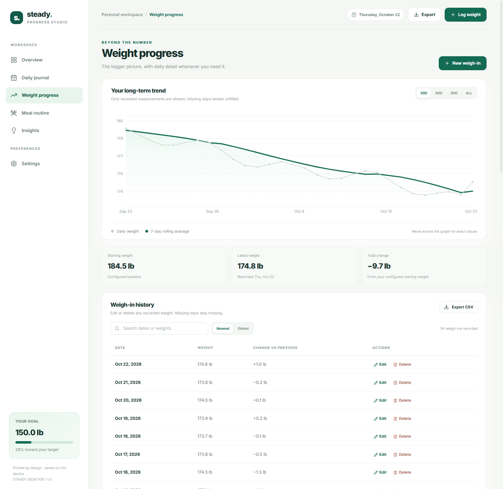
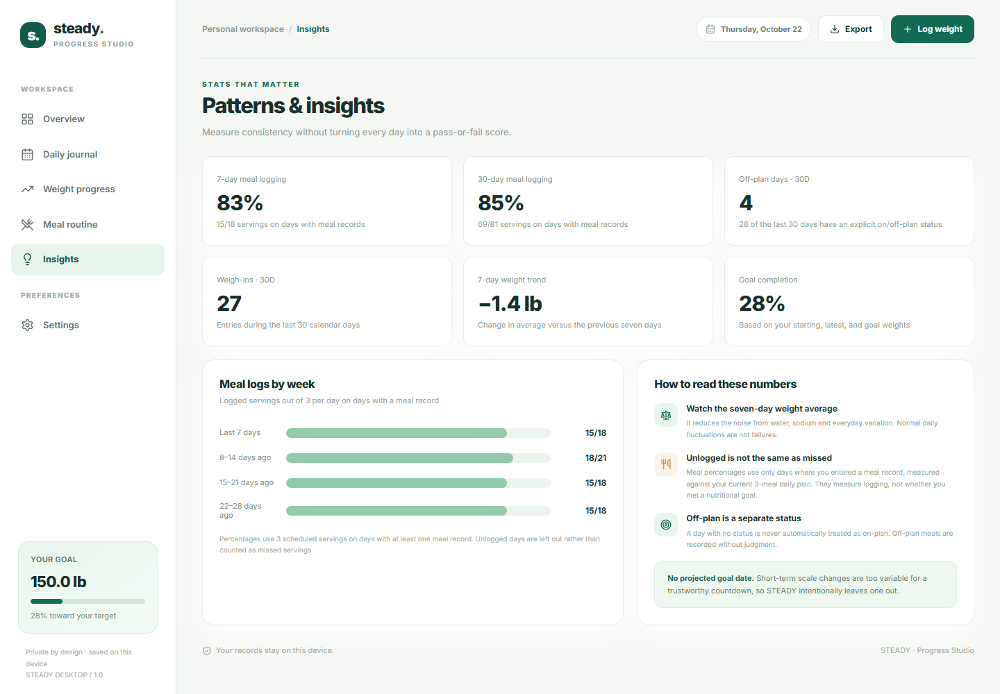
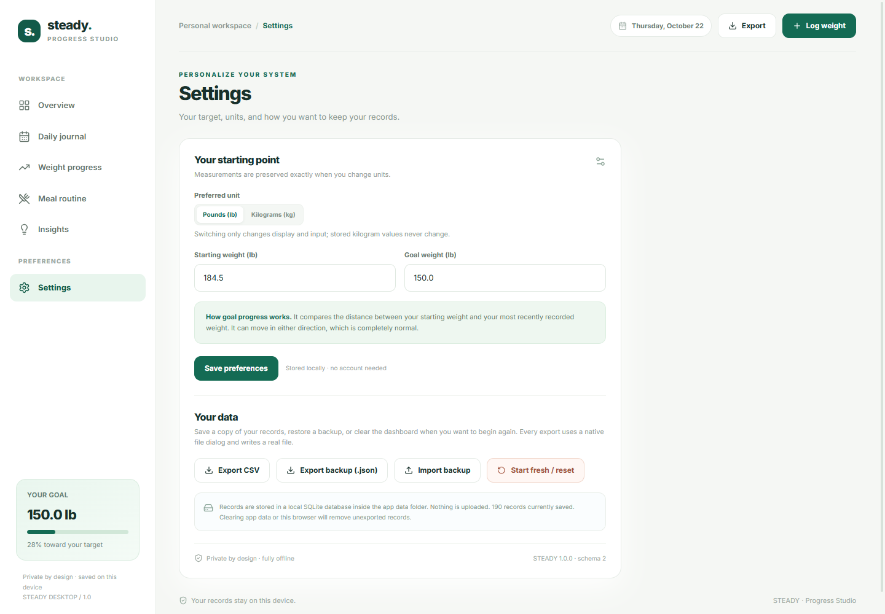

<div align="center">


# STEADY

**Progress, without the noise.**

A private, offline-first weight-loss studio for Windows and macOS.

[](#install)
[](https://tauri.app)
[](https://react.dev)
[](#privacy-by-design)
[](#privacy-by-design)

</div>



STEADY is a desktop weight-loss tracker built around a simple carnivore routine. Choose one to six daily meals, save the recipes you actually eat, check each serving off in a tap, and record whether the day included an off-plan meal. No feeds, no accounts, no cloud.

> Screenshots show an optional demo profile. The installed app starts empty and never seeds fabricated history.

## Designed to stay out of your way

<table>
<tr>
<td width="50%" valign="top">

### One-tap routine

Your daily meals are always one click away. Shared recipe or individual recipes, STEADY adapts every screen to your own schedule.

</td>
<td width="50%" valign="top">

### Honest numbers

Rolling averages use real calendar days. Missing weigh-ins stay missing. Unlogged meals are never counted as failures.

</td>
</tr>
<tr>
<td width="50%" valign="top">

### Quiet by default

No notifications, streaks, scores, or moralizing. Just the records you chose to keep, presented clearly.

</td>
<td width="50%" valign="top">

### Yours to keep

A local SQLite database, plain CSV export, and validated JSON backups with native file dialogs.

</td>
</tr>
</table>

## A closer look

<table>
<tr>
<td width="50%" valign="top">

<p align="center"><sub><strong>Daily journal</strong> — meals, off-plan status, weigh-in, notes, and a readable 14-day history.</sub></p>
</td>
<td width="50%" valign="top">

<p align="center"><sub><strong>Meal routine</strong> — choose 1–6 meals, then share one recipe or give each meal its own.</sub></p>
</td>
</tr>
<tr>
<td width="50%" valign="top">

<p align="center"><sub><strong>Weight progress</strong> — real weigh-ins, a seven-day rolling average, and editable history.</sub></p>
</td>
<td width="50%" valign="top">

<p align="center"><sub><strong>Insights</strong> — explicit numerators, honest denominators, and no projected goal dates.</sub></p>
</td>
</tr>
</table>

## What is included

### Overview
- Four transparent KPIs: current weight, 30-day change, weekly trend, and 7-day meal tracking.
- A 30/60/90-day weight chart with raw weigh-ins, a seven-calendar-day rolling average, and an accessible summary.
- One-tap check-ins for every daily meal and an independent **No / Yes** off-plan control. Neither is preselected.
- Goal destination with clamped progress, a four-week Monday–Sunday consistency calendar, and calm at-a-glance insights.

### Daily journal
- Date navigation with future dates blocked, plus a color-coded 14-day strip.
- Every scheduled meal with logged-at times, editable off-plan status, an optional weigh-in, and a persistent daily note.
- Historical edits immediately recalculate every related chart and statistic.

### Weight progress
- 30/60/90/all-time charts with daily weights and the seven-calendar-day rolling average.
- Searchable, sortable weigh-in history with per-entry editing and confirmed deletion.
- Starting weight, latest weight, and total change. Missing days are never interpolated.

### Meal routine
- Choose **1–6 meals per day**. Every check-in, calendar, and analytic follows the selected plan.
- Use one shared recipe for every serving, or switch it off and create a separate recipe for each meal.
- Optional per-serving calories, protein, and fat. Nutrition is never estimated.
- Each logged serving keeps a snapshot of the recipe, so editing a template cannot rewrite history.

### Insights
- 7- and 30-day meal logging with visible numerators and denominators.
- Off-plan count with the number of days that actually have a status.
- 30-day weigh-in count, seven-day average comparison with a minimum-data rule, and goal completion.
- Four rolling seven-day meal-log bars, plus context about normal weight fluctuation and unlogged days.

### Settings and data ownership
- Starting weight, goal weight, and lb/kg switching. Weights are stored canonically in kilograms; changing units never mutates recorded measurements.
- CSV export, versioned JSON full backup, validated JSON restore, and a confirmed full reset.
- Native save/open dialogs and real file writes. Imports are validated before any write; a failed write restores the previous snapshot.

<p align="center">

</p>

## Analytics rules

These rules live in pure functions under [`src/lib/analytics`](src/lib/analytics) and are covered by tests.

- **Seven-day rolling average** uses recorded weigh-ins from the trailing seven **calendar** days, not the last seven measurements. Long gaps produce no average instead of borrowing old data.
- **Weekly trend** compares the current seven days with the previous seven and returns `—` unless each window has at least three readings.
- **30-day change** uses the first and last actual weigh-ins inside the 30-calendar-day window and needs at least two entries.
- **Goal progress** is `(start − current) / (start − goal)`, clamped to 0–100%, and only shown with valid start, goal, and current values. The goal must be below the starting weight.
- **Meal tracking** uses your current scheduled meal count only on days with at least one explicit meal record. Unlogged days are excluded, never treated as missed meals or cheating. Percentages always have a visible numerator and denominator.
- **Off-plan** is a separate explicit status. Absence of a status is never counted as on-plan.
- **No projected goal date** is shown; short-term scale noise makes one untrustworthy.
- Weights are never fabricated, interpolated, or treated as zero.

## Privacy by design

No network requests are made by the application. There is no account, telemetry, analytics, advertising, or cloud dependency. The only external integrations are the operating system’s native file dialogs.

The SQLite database `steady.db` is created by the official Tauri SQL plugin in the platform app-data directory:

| Platform | Database location |
|---|---|
| Windows | `%APPDATA%\com.steady.progress\steady.db` |
| macOS | `~/Library/Application Support/com.steady.progress/steady.db` |
| Linux (development) | `~/.config/com.steady.progress/steady.db` |

Exports and backups are written only to paths you choose. Imported backups are validated in memory before any record is touched. Backups include a schema version; newer schemas are rejected with an actionable message.

## Install

STEADY ships as a native Tauri app and opens **maximized** by default, with the native title bar kept in place so you can close, move, or resize the window.

Prebuilt installers are produced by [the packaging workflow](.github/workflows/build.yml):

1. Open **Actions → Verify and package STEADY → Run workflow**.
2. Download the artifact for your platform:
   - `steady-windows-x64` — Windows NSIS installer.
   - `steady-macos-intel` — Intel Mac DMG.
   - `steady-macos-apple-silicon` — Apple Silicon DMG.

The current builds are unsigned. Windows SmartScreen and macOS Gatekeeper will warn on first launch until code signing and notarization credentials are configured. See [CI installers](#ci-installers) for the signing variables.

### Build it yourself

```bash
npm ci

# Windows installer (NSIS)
npm run tauri build -- --bundles nsis
# -> src-tauri\target\release\bundle\nsis\STEADY_1.0.0_x64-setup.exe

# macOS disk image
npm run tauri build -- --bundles dmg
# -> src-tauri/target/release/bundle/dmg/STEADY_1.0.0_<arch>.dmg
```

Windows `.msi` (WiX) can be produced with `--bundles msi` when WiX is available.

## Development

### Prerequisites

- Node.js 22 or newer and npm
- Rust stable (1.77.2 or newer)
- Platform prerequisites for Tauri 2:
  - **Windows:** Microsoft C++ Build Tools (Desktop development with C++) and WebView2 (preinstalled on Windows 10/11).
  - **macOS:** Xcode Command Line Tools.
  - **Linux:** WebKitGTK and related Tauri development packages. Desktop targets are Windows and macOS; Linux is useful only for development.

### Run

```bash
npm ci
npm run tauri dev
```

The web UI alone can be reviewed with `npm run dev` at `http://127.0.0.1:5173`. That mode uses a clearly labelled browser-only development adapter; the packaged desktop app always uses SQLite.

### Checks

```bash
npm run lint
npm test
npm run build
```

`npm test` runs Vitest with jsdom interaction tests and `node:sqlite` repository tests against the real migrations and SQL statements. Node’s experimental SQLite module is intentionally invoked with `--experimental-sqlite`.

### CI installers

[`.github/workflows/build.yml`](.github/workflows/build.yml) runs lint, all tests, and the web build on every pull request. On manual runs and `v*` tags it also builds and uploads:

- `steady-windows-x64` — NSIS `.exe` from `windows-latest`.
- `steady-macos-intel` — `.dmg` from `macos-15-intel` (x86_64).
- `steady-macos-apple-silicon` — `.dmg` from `macos-15` (arm64).

Artifacts are retained for 14 days. The workflows require no signing credentials, but public distribution should add:

- Windows Authenticode signing (`TAURI_SIGNING_PRIVATE_KEY` is for updater signatures and does **not** replace Authenticode).
- Apple Developer ID signing and notarization (`APPLE_CERTIFICATE`, `APPLE_SIGNING_IDENTITY`, `APPLE_ID`, `APPLE_PASSWORD`, `APPLE_TEAM_ID`).

No installer artifacts are committed to this repository.

## Design fidelity

The interface follows the supplied `STEADY_Desktop_UI_UX_Spec.md`, `STEADY_Interactive_Prototype.html`, and `dashboard_preview.png`: the 254 px sidebar, `#F5F7F4` canvas, white 18 px-radius cards, `#18302B` ink, forest-green primary actions, compact premium typography, and quiet borders. All six sections are implemented as modular React/TypeScript screens rather than embedding the prototype HTML.

Deliberate departures from the browser prototype:

- **No demo dataset is seeded.** First-run setup collects units, starting weight, goal, meal count, and the recurring recipe. Empty states are real. The browser design preview uses browser storage only and is never part of the packaged app.
- **SQLite replaces localStorage** as the canonical datastore, with schema migrations and typed repositories.
- **Recharts** renders the weight charts, with custom tokens, tooltips, empty states, and screen-reader summaries.
- **Off-plan is a three-state model** (absent, on-plan, off-plan), and meal denominators only include days with an explicit meal record.
- **Meal count is configurable** from 1 to 6, with shared or individual recipes per meal.
- **Accessible additions** include visible focus rings, keyboard-trapped dialogs, focus restoration, chart summaries, non-color calendar labels, reduced-motion support, and inline validation.
- **Exports use native dialogs** through the Tauri dialog plugin and narrowly scoped Rust file commands, rather than browser downloads.

## Project layout

```
src/
  components/        layout, overview cards, charts, dialogs, UI primitives
  pages/             the six sections
  features/          reusable export hooks
  hooks/             app data provider and live local date
  lib/               dates, units, analytics, CSV, backups, file IO
  db/                schema migrations, SQLite + browser repositories
  types/             shared typed data model
tests/               analytics, backup, SQL repository, and UI tests
docs/screenshots/    native app screenshots used in this README
src-tauri/           Tauri 2 Rust shell, capabilities, bundle config, icons
.github/workflows/   verification and native installer CI
```

The supplied reference files (`STEADY_CODEX_BUILD_PROMPT.md`, `STEADY_Desktop_UI_UX_Spec.md`, `STEADY_Interactive_Prototype.html`, `dashboard_preview.png`) remain alongside the implementation as design documentation.

<div align="center">
<br />
<sub>STEADY · Progress Studio — built to be calm, honest, and entirely yours.</sub>
</div>
